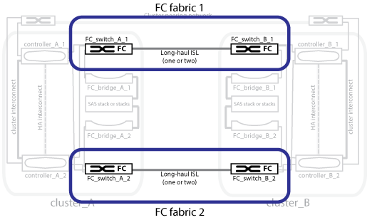

= MetroCluster FC構成における冗長スイッチファブリック
:allow-uri-read: 
:icons: font
:imagesdir: ../media/

[role="lead"]
各スイッチファブリックには、サイトを接続するスイッチ間リンク（ ISL ）が含まれています。データは、サイトからサイトへ、 ISL 経由でレプリケートされます。冗長性を確保するためには、各スイッチファブリックを異なる物理パスに配置する必要があります。

.関連情報
link:concept_illustration_of_the_local_ha_pairs_in_a_mcc_configuration.html["MetroCluster 構成のローカル HA ペアの図"]

link:concept_illustration_of_redundant_fc_to_sas_bridges.html["冗長 FC-to-SAS ブリッジの図"]

link:concept_cluster_peering_network_mcc.html["クラスタピアリングネットワークの図"]
